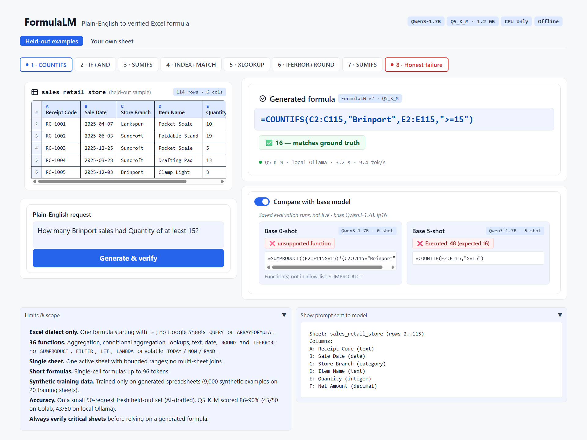
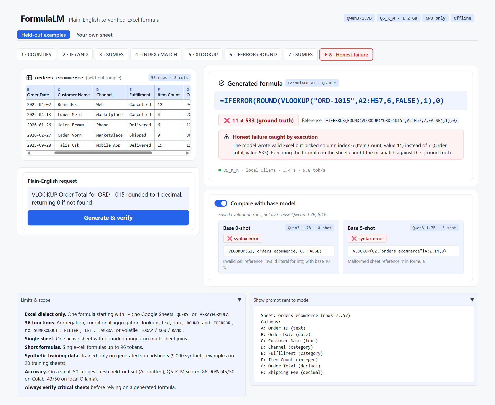
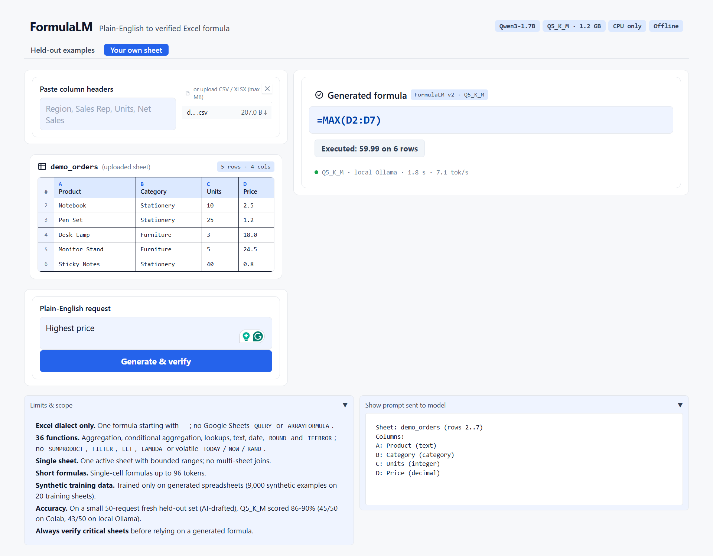

# FormulaLM

**One-line pitch:** A QLoRA-tuned, `Q5_K_M`-quantized `Qwen3-1.7B` model that turns a spreadsheet schema and plain-English request into an executable Excel formula (`=...`), verified by running every formula against the sheet — locally on a CPU-only laptop.

- **Fresh held-out set (`test_real_v2`, `N = 50`, 95% Wilson CIs):** Shipped **`Q5_K_M` GGUF** scores **45/50 (90.0%, `[78.6%, 95.7%]`)** on Colab `llama-server` and **43/50 (86.0%, `[73.8%, 93.0%]`)** on local Ollama, against base `Qwen3-1.7B` **23/50 (46.0%, `[33.0%, 59.6%]`)** zero-shot and **29/50 (58.0%, `[44.2%, 70.6%]`)** five-shot (16-bit `v2-ship` adapter: **44/50, 88.0%**, `[76.2%, 94.4%]`).
- **Local CPU footprint (`results/local_benchmark/`):** **`Q5_K_M` GGUF** is **1,199.6 MB (~1.20 GB)** on disk, loads in **2.64 s**, uses **1,476.5 MB (~1.48 GB) peak RAM**, and generates at **11.3 tok/s** on an **Intel Core i5-8365U, 8 GB RAM, CPU-only** Windows 11 laptop (`Ollama 0.40.18`).
- **Links:** [GitHub Repo](https://github.com/abubakarp789/FormulaLM) · [Hugging Face GGUF](https://huggingface.co/abubakar56/formulalm-qwen3-1.7b-gguf) ([v2 LoRA](https://huggingface.co/abubakar56/formulalm-qwen3-1.7b-lora-v2) · [v1 LoRA fallback](https://huggingface.co/abubakar56/formulalm-qwen3-1.7b-lora)) · [ModelScope GGUF](https://www.modelscope.ai/models/abubakar56/formulalm-qwen3-1.7b-gguf) ([v2 LoRA](https://www.modelscope.ai/models/abubakar56/formulalm-qwen3-1.7b-lora-v2) · [v1 LoRA fallback](https://www.modelscope.ai/models/abubakar56/formulalm-qwen3-1.7b-lora)) · **Demo video:** _TODO: [2–3 min local demo video link — placeholder until uploaded]_
- **Author:** Abu Bakar ([`abubakarp789`](https://github.com/abubakarp789); Hugging Face & ModelScope: `abubakar56`)
- **Model weights:** Large files (GGUF weights and LoRA adapters) are hosted on Hugging Face and ModelScope and are not stored in this repository.

| Hackathon Deliverable | Status | Location |
|---|---|---|
| Fine-tuned + quantized model published | Done | HF & ModelScope `abubakar56/formulalm-qwen3-1.7b-{gguf,lora-v2,lora}` (`Apache-2.0`) |
| Public GitHub repository + reproducible README | Done | [`abubakarp789/FormulaLM`](https://github.com/abubakarp789/FormulaLM) (`MIT`), all numbers from [`results/`](results/) |
| 2–3 minute local demo video | Pending upload | Placeholder above — to be recorded on local `i5-8365U` Gradio + Ollama setup |

---

## Problem & Why Running Locally Matters

Spreadsheet users usually know the question they want answered (*"Total Shipping Fee for Marketplace orders that are Shipped"*) rather than exact `SUMIFS`, `INDEX`+`MATCH`, or `XLOOKUP` argument order. Cloud LLMs can write formulas, but real workbooks hold payroll, invoices, student grades, and inventory ledgers that often cannot be sent to external APIs, and offline/low-budget workflows cannot depend on paid endpoints. A **1.20 GB** local model running in **~1.48 GB RAM** answers formula queries offline in a few seconds while keeping spreadsheet data on the machine.

---

## Quick-Start (5 Steps)

Exact workflow verified from a clean temporary folder by [`scripts/verify_published_download.py`](scripts/verify_published_download.py):

1. **Install [Ollama](https://ollama.com)** (`0.40+`).
2. **Download `formulalm-qwen3-1.7b-v2-q5_k_m.gguf` (1.20 GB) and `Modelfile`** into an empty folder:
   ```bash
   # Option A — Hugging Face:
   curl -LO https://huggingface.co/abubakar56/formulalm-qwen3-1.7b-gguf/resolve/main/formulalm-qwen3-1.7b-v2-q5_k_m.gguf
   curl -LO https://huggingface.co/abubakar56/formulalm-qwen3-1.7b-gguf/resolve/main/Modelfile
   # Option B — ModelScope:
   curl -LO https://www.modelscope.ai/models/abubakar56/formulalm-qwen3-1.7b-gguf/resolve/master/formulalm-qwen3-1.7b-v2-q5_k_m.gguf
   curl -LO https://www.modelscope.ai/models/abubakar56/formulalm-qwen3-1.7b-gguf/resolve/master/Modelfile
   ```
3. **Create the local Ollama model:**
   ```bash
   ollama create formulalm -f Modelfile
   ```
4. **Run an example (`--think=false` keeps Qwen3 in non-thinking formula-only mode):**
   ```bash
   ollama run --think=false formulalm $'Sheet: sales_retail_store (rows 2..115)\nColumns:\nA: Receipt Code (text)\nB: Sale Date (date)\nC: Store Branch (category)\nD: Item Name (text)\nE: Quantity (integer)\nF: Net Amount (decimal)\n\nRequest: Total Net Amount for the Mirehaven branch'
   # Expected output: =SUMIF(C2:C115,"Mirehaven",F2:F115)
   ```
5. **Optional — launch the local Gradio demo (works without a pre-populated `models/` folder):**
   ```powershell
   git clone https://github.com/abubakarp789/FormulaLM.git
   cd FormulaLM
   uv sync
   .\scripts\run_demo.ps1   # uses existing 'formulalm' Ollama tag, or auto-downloads Q5_K_M into models\gguf_v2\
   ```

---

## Headline Results (All Numbers from `results/`)

Every formula is executed in Python `formulas` 1.3.4 on the `.xlsx` sheet and compared against an independent pandas ground truth (`tol=1e-6`). Brackets show **95% Wilson CIs** ([`results/final_headline.md`](results/final_headline.md), [`results/quant_comparison.md`](results/quant_comparison.md), [`results/local_benchmark/local_benchmark.md`](results/local_benchmark/local_benchmark.md)).

### 1. Base vs Fine-Tuned vs Quantized (Colab T4 Evaluation)

| System | Size (MB) | `test_real_v2` Exec Acc (`N=50`) | `test_real_v2` Exact | `test_real` Exec Acc (`N=80`)\* | `test_real` Exact\* | `test_synthetic` Exec Acc (`N=500`)\* | `val` Exec Acc (`N=500`) |
|---|---:|---|---:|---|---:|---|---|
| Base `Qwen3-1.7B` (0-shot, fp16) | — | **46.0%** `[33.0%, 59.6%]` | 40.0% | **50.0%** `[39.3%, 60.7%]` | 42.5% | **44.6%** `[40.3%, 49.0%]` | _n/a_ |
| Base `Qwen3-1.7B` (5-shot, fp16) | — | **58.0%** `[44.2%, 70.6%]` | 46.0% | **51.2%** `[40.5%, 61.9%]` | 41.2% | **60.2%** `[55.9%, 64.4%]` | _n/a_ |
| Fine-tuned v1 (`v1-frozen`, fp16) | 66.6 (LoRA) | **88.0%** `[76.2%, 94.4%]` | 82.0% | **91.2%** `[83.0%, 95.7%]` | 91.2% | **97.6%** `[95.9%, 98.6%]` | **99.6%** `[98.6%, 99.9%]` |
| **Fine-tuned v2 (`v2-ship`, fp16)** | 66.6 (LoRA) | **88.0%** `[76.2%, 94.4%]` | 86.0% | **93.8%** `[86.2%, 97.3%]`\* | 93.8%\* | **98.8%** `[97.4%, 99.5%]`\* | **99.6%** `[98.6%, 99.9%]` |
| v2 Merged `F16` GGUF *(ref only)* | 3,287.7 | **88.0%** `[76.2%, 94.4%]` | 86.0% | **93.8%** `[86.2%, 97.3%]`\* | 93.8%\* | **98.8%** `[97.4%, 99.5%]`\* | **99.8%** `[98.9%, 100.0%]` |
| v2 `Q8_0` GGUF | 1,749.5 | **86.0%** `[73.8%, 93.0%]` | 82.0% | **93.8%** `[86.2%, 97.3%]`\* | 93.8%\* | **98.6%** `[97.1%, 99.3%]`\* | **99.8%** `[98.9%, 100.0%]` |
| **v2 `Q5_K_M` GGUF (Shipped)** | **1,199.6** | **90.0%** `[78.6%, 95.7%]` | **88.0%** | **93.8%** `[86.2%, 97.3%]`\* | **93.8%**\* | **98.4%** `[96.9%, 99.2%]`\* | **99.6%** `[98.6%, 99.9%]` |
| v2 `Q4_K_M` GGUF | 1,056.1 | **90.0%** `[78.6%, 95.7%]` | 86.0% | **88.8%** `[80.0%, 94.0%]`\* | 88.8%\* | **95.4%** `[93.2%, 96.9%]`\* | **97.4%** `[95.6%, 98.5%]` |

### 2. Local CPU Benchmark (Windows 11, Intel Core i5-8365U, 8 GB RAM, No GPU, Ollama `0.40.18`)

| Quantization | File Size | Load Time | Peak RAM | Speed | Local `test_real_v2` (`N=50`) | Local `test_real` (`N=80`)\* | Combined 130-ex Exec Acc |
|---|---:|---:|---:|---:|---|---|---|
| `Q4_K_M` GGUF | 1,056.1 MB | 4.60 s | 1,333.0 MB | 12.7 tok/s | 88.0% (44/50, exact 84.0%) | 90.0% (72/80, exact 90.0%)\* | **89.2%** `[82.7%, 93.5%]` |
| **`Q5_K_M` GGUF (Shipped)** | **1,199.6 MB** | **2.64 s** | **1,476.5 MB** | **11.3 tok/s** | **86.0%** (43/50, exact 84.0%) | **93.8%** (75/80, exact 93.8%)\* | **90.8%** `[84.6%, 94.6%]` |
| `Q8_0` GGUF | 1,749.5 MB | 5.93 s | 2,026.4 MB | 7.8 tok/s | 88.0% (44/50, exact 86.0%) | 93.8% (75/80, exact 93.8%)\* | **91.5%** `[85.5%, 95.2%]` |

**Key findings & honest caveats (not buried):**
- **`v1` and `v2` are statistically tied:** on `val` (`99.6%`, 498/500) and the fresh held-out set `test_real_v2` (`88.0%`, 44/50), `v1` and `v2` tie exactly. `v2` ships (`SHIP_V2`, [`docs/DECISION.md`](docs/DECISION.md)) because it passed all pre-registered gates and achieved lower validation loss (`0.003975` vs `0.004240`). Frozen `v1` stays public as `v1-frozen`.
- **\*Analysis-informed v2 splits:** `v2`'s small gains on `test_real` (+2.5 pp) and `test_synthetic` (+1.2 pp) have overlapping 95% Wilson CIs and are **informed by v1 error analysis** (v2 train-only data targeted v1 error clusters on those splits).
- **Why `Q5_K_M` over `Q4_K_M`:** 4-bit `Q4_K_M` loses **2.4–5.0 pp** vs `F16` (`-2.4 pp` on `val`, `-3.4 pp` on `test_synthetic`, `-5.0 pp` on `test_real`), whereas `Q5_K_M` stays within **-0.4 to +2.0 pp** (sampling noise) of `F16` for only **+143.5 MB** extra disk/RAM.
- **Colab vs local Ollama variance:** local CPU Ollama (`0.40.18`) and Colab CUDA `llama-server` (`b12728`) can differ by **1–2 examples** (`Q5_K_M` scores 45/50 = 90.0% on Colab vs 43/50 = 86.0% on local Ollama on `test_real_v2`; both score 75/80 = 93.8% on `test_real`).

---

## Base Model, Data & Authorship

- **Base model:** [`Qwen/Qwen3-1.7B`](https://huggingface.co/Qwen/Qwen3-1.7B) pinned at revision `70d244cc86ccca08cf5af4e1e306ecf908b1ad5e` (`Apache-2.0`), run strictly in **non-thinking mode** (`enable_thinking=False`) so output is only `=...` ([`docs/MODEL_PROVENANCE.md`](docs/MODEL_PROVENANCE.md)).
- **Synthetic dataset ([`data/DATASET_CARD.md`](data/DATASET_CARD.md)):** 100% synthetic across **25 generated `.xlsx` sheets** spanning 11 domains (**20 training sheets**, **5 held-out test sheets**: `sales_retail_store`, `hr_employee_roster`, `inventory_stock_movements`, `grades_course_scores`, `orders_ecommerce`), covering **36 non-volatile Excel functions** with zero personal/private data. No model-generated paraphrase augmentation or scraped data was used; templates, phrasing patterns, and code were written with an AI coding assistant.
  - **Splits:** `train.jsonl` (8,000), `train_v2.jsonl` (9,000, train sheets only), frozen `val.jsonl` (500), frozen `test_synthetic.jsonl` (500 on the 5 held-out sheets + 2 reserved phrasings/template), `data/test_real/test_real_DRAFT.csv` (80 requests, filename kept for compatibility with saved results: AI-drafted, reviewed and approved by Abu Bakar on 26 November 2026), and `data/test_real_v2/test_real_v2.csv` (50 fresh held-out requests: AI-drafted with access to the repository including the v1 error analysis, reviewed and approved by Abu Bakar on 26 November 2026; therefore not fully independent, and small, `N = 50`).
  - **Leakage checks:** automated tests (`tests/test_dataset.py`, `tests/test_v2_iteration.py`) enforce zero sheet overlap between train/val and held-out test splits, zero phrasing-template leakage, zero exact prompt duplicates, and 100% executor ground-truth agreement (`0` dropped rows).
- **Authorship statement:** Author and repository owner: Abu Bakar (GitHub: `abubakarp789`; Hugging Face and ModelScope: `abubakar56`). Abu Bakar conceived the project and defined the task, scope, evaluation design and all engineering decisions; ran all training, evaluation, quantization and local CPU benchmarks; published the models; and reviewed and approved all code, synthetic data, test sets and results in this repository. An AI coding assistant (Google Antigravity) was used under his direction to help generate code and synthetic data (templates, phrasing patterns, sheets) and to draft test requests; all AI-assisted output was reviewed and approved by Abu Bakar. Code and synthetic data: MIT. Fine-tuned adapters and quantized GGUF weights are Apache-2.0 derivatives of `Qwen/Qwen3-1.7B`.

---

## Method, Evaluation & Error Analysis

- **QLoRA training (`notebooks/train_qlora.ipynb`, Unsloth `2026.11.10`, Google Colab Tesla T4 14.56 GB VRAM):** 4-bit QLoRA (`r=16`, `lora_alpha=32`, `lora_dropout=0.0`, all 7 linear projections `q/k/v/o/gate/up/down_proj`), `max_seq_length=512`, `train_on_responses_only=True`, effective batch size 16 (`4 × 4`), `adamw_8bit`, cosine schedule, `seed=42`.
  - **`qlora_v1` (`results/train_qlora_v1/run_summary.json`):** 2 epochs (1,000 steps), `lr=2e-4`, **34.6 min** (`2,073 s`) on Colab T4, peak **1.65 GB VRAM**, best `checkpoint-200` (`val_loss = 0.004240`).
  - **`qlora_v2` (`v2-ship`, `results/train_qlora_v2/run_summary.json`):** 1 epoch (563 steps), `lr=1e-4`, `weight_decay=0.05`, `warmup_ratio=0.08`, `eval_steps=50`, **19.0 min** (`1,138 s`) on Colab T4, peak **4.19 GB VRAM**, best `checkpoint-400` (`val_loss = 0.003975`).
- **Merge & GGUF quantization (`notebooks/05_merge_quantize.ipynb`):** `v2-ship` adapter merged explicitly into fp16 `Qwen/Qwen3-1.7B@70d244cc` and quantized via `llama.cpp` `b12728`. Prompt-format parity check (`results/quant_parity/parity_report.md`) confirmed **20/20 (100.0%)** exact output agreement between HF FP16 and GGUF F16.
- **Executable evaluation (`src/eval/executor.py`):** static safety/allow-list validator (rejects `eval`/`exec`, external refs, URLs, DDE, and out-of-scope functions) + cached `formulas` 1.3.4 AST execution + type-aware comparison (`tol=1e-6`). Syntax validity moved from **71.8%–81.2%** (base 0-shot) to **99.6%–100.0%** (`v2-ship` `Q5_K_M`).
- **Error analysis (`results/ft_v1_comparison.md`, [`docs/v2_changelog.md`](docs/v2_changelog.md)):** `v1` made 19 total errors across 580 test examples (`wrong_function`: 8, `wrong_aggregation`: 4, `wrong_column`: 4, `wrong_argument_order`: 3, `syntax_error`: 0, `over_generation`: 0) and overfit during Epoch 2 (`train_loss -> 0.0000`, `val_loss -> 0.0095`). Cutting `v2` to 1 epoch at `lr=1e-4` plus 58 train-only phrasings and 2 `IFERROR(ROUND(A/B))` templates eliminated Epoch-2 overfitting.

---

## Local Gradio Demo (`app/app.py`)

```powershell
.\scripts\run_demo.ps1                 # sets OLLAMA_MAX_LOADED_MODELS=1, opens http://127.0.0.1:7860
.\scripts\run_demo.ps1 -Backend mock   # offline UI smoke mode (no Ollama server needed)
```

- **Features:** Compact 2-tab 1080p layout (**Held-out examples** + **Your own sheet** with CSV/XLSX upload `<= 1.0 MB` or pasted column headers synthesizing 5 sample rows); 8 short example buttons including 1 red-outlined honest failure (`real_v2_050`); formula copy button; live `formulas` verdict pill + ground truth; one-line latency/quantization meta with background startup warm-up (`keep_alive=30m`); and offline **saved Base `Qwen3-1.7B`** side-by-side cards (`results/baseline_*`, never loads a second model on 8 GB RAM).
- **Local screenshots (`Q5_K_M` on local Ollama):**
  1. **Held-out win + saved Base `Qwen3-1.7B` failures (`docs/screenshots/demo_win.png`):** `real_v2_005` (`=COUNTIFS(...)` → `16`, `3.2 s`, `9.4 tok/s`)
     
  2. **Honest failure caught by execution (`docs/screenshots/demo_honest_failure.png`):** `real_v2_050` (`VLOOKUP` column `6` vs `7`: `11 ≠ 533`, `3.4 s`, `9.8 tok/s`)
     
  3. **Custom uploaded sheet (`docs/screenshots/demo_custom_headers.png`):** `demo_orders.csv` (`Highest price` → `=MAX(D2:D7)` → `Executed: 59.99 on 6 rows`, `1.8 s`, `7.1 tok/s`)
     

---

## Reproduce from a Clean Clone

```powershell
git clone https://github.com/abubakarp789/FormulaLM.git
cd FormulaLM
uv sync

# 1. Run uv run pytest (full unit & leakage test suite, CPU-only, about 1 minute)
uv run pytest

# 2. Regenerate synthetic sheets (25 .xlsx) and verified JSONL splits (train/train_v2/val/test_synthetic)
uv run python -m src.data.sheets
uv run python scripts/generate_data.py
uv run python -m src.data.build_dataset --version v2
uv run python -m src.eval.test_real_v2 --mode annotated data/test_real_v2/test_real_v2.csv

# 3. Smoke-test evaluator offline, or run clean-download Ollama verifier
uv run python -m src.eval.run_eval --run-name repro_mock --backend mock --dataset data/test_real_v2/test_real_v2.csv --limit 10
uv run python scripts/verify_published_download.py --source hf

# 4. Regenerate comparison reports from saved results/
uv run python -m src.eval.compare_v1_v2
uv run python -m src.eval.compare_quant
```

**GPU stages (run on free Google Colab Tesla T4, 14.56 GB VRAM):** `notebooks/01_baseline_eval.ipynb` (~12 min), `notebooks/train_qlora.ipynb` (`v1`: 34.6 min; `v2`: 19.0 min), `notebooks/02_eval_ft_v1.ipynb` (~12 min), `notebooks/03_eval_ft_v2.ipynb` (~15 min), `notebooks/04_eval_base_real_v2.ipynb` (~5 min), and `notebooks/05_merge_quantize.ipynb` (merge + `llama.cpp` GGUF export + 16-run quantization eval, ~25 min).

---

## Limitations, Concrete Failure Modes & Future Work

- **Excel dialect & ~35 functions only (36 exact):** single-sheet, single-cell formulas (`<= 96` tokens). No multi-sheet joins, no `SUMPRODUCT` / `FILTER` / `LET` / `LAMBDA`, no Google Sheets `QUERY` / `ARRAYFORMULA`, and no volatile `TODAY` / `NOW` / `RAND`.
- **Concrete failure case (`real_v2_050`):** on `orders_ecommerce`, asked to `VLOOKUP Order Total for ORD-1015`, `Q5_K_M` outputs syntactically valid `=IFERROR(ROUND(VLOOKUP("ORD-1015",A2:H57,6,FALSE),1),0)`, counting `col_index_num=6` (`Item Count`, returning `11.0`) instead of `7` (`Order Total`, `533.0`). Other remaining errors on `test_real_v2` involve inequality direction (`>` vs `<` on `real_v2_029`) and abbreviated category strings (`"<>C"` vs `"<>Sec C"` on `real_v2_034`).
- **Benchmark constraints:** the fresh held-out set `test_real_v2` has `N = 50` examples (95% Wilson CIs about 17-20 pp wide (roughly ±9 pp)), training data is 100% synthetic, and `test_real_v2` was drafted by an AI assistant with access to the repository including the v1 error analysis (reviewed and approved by Abu Bakar on 26 November 2026) and is therefore not fully independent.
- **Future work:** collect an independently human-authored real workbook benchmark; add explicit 1-based column indices (`G [col 7]: Order Total`) to the prompt schema to eliminate `VLOOKUP` off-by-one errors; and support modern Excel dynamic arrays (`FILTER`, `XLOOKUP` multi-column, `LET`).

---

## Credits & License

- **Credits:** [Qwen Team](https://github.com/QwenLM) (`Qwen/Qwen3-1.7B`); [Unsloth](https://github.com/unslothai/unsloth) for fast T4 QLoRA; Junaid Shaukat & Qwen Pakistan for the organizer starter repo [`junaiddshaukat/finetune-anywhere`](https://github.com/junaiddshaukat/finetune-anywhere); [`llama.cpp`](https://github.com/ggml-org/llama.cpp); [Ollama](https://github.com/ollama/ollama); [`formulas`](https://github.com/vinci1it2000/formulas); and [Gradio](https://github.com/gradio-app/gradio).
- **Licenses & Ownership:** Copyright (c) 2026 Abu Bakar. Repository source code and synthetic data are licensed under **MIT** ([`LICENSE`](LICENSE)). Fine-tuned LoRA adapters and quantized GGUF weights inherit **Apache-2.0** from [`Qwen/Qwen3-1.7B`](https://huggingface.co/Qwen/Qwen3-1.7B).
